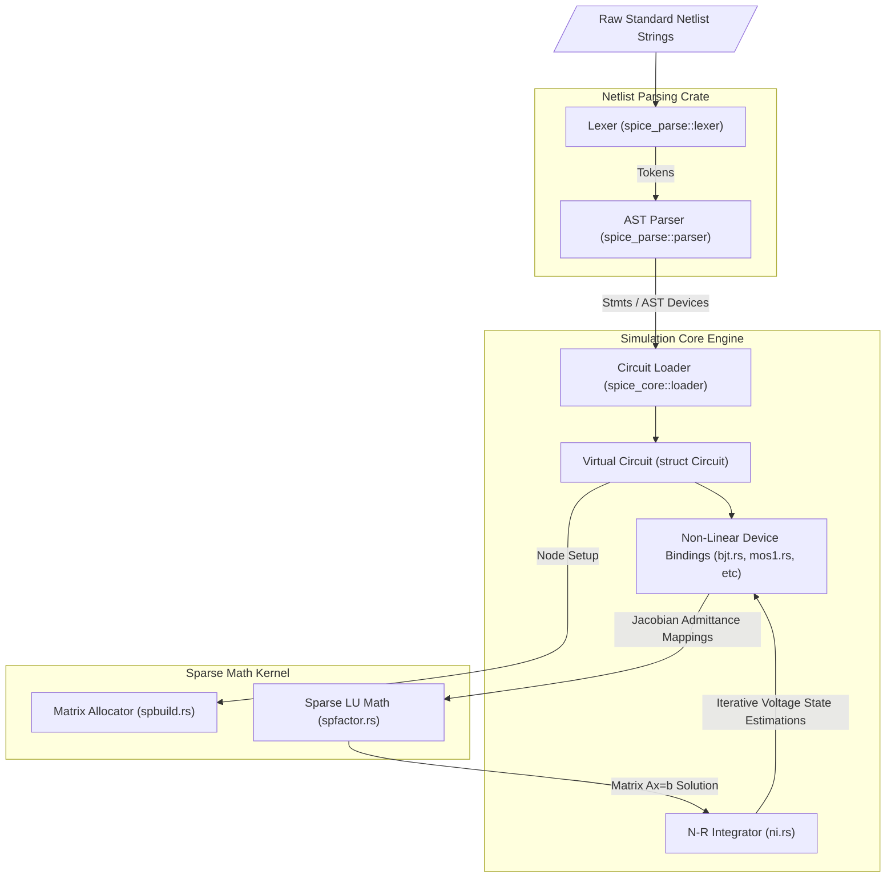

# Architectural Overview

The core requirement of replacing legacy C `SPICE3` with a modern implementation was establishing hard decoupled safety boundaries over numerical arrays without suffering overhead costs. To achieve this, the workspace is split fundamentally into three parallel systems: Math, Data/Core, and Parsing.

## The Crate Workspace Boundary 

### 1. `spice_math`
This library contains the foundational data structures mapping numeric physical connections (Matrix nodes). Rather than using `malloc()` mapping tables everywhere over pointer addresses computationally (as historical `SPARSE1.3` did), we mapped exactly the same memory traversal logic through statically contiguous generic `Vec` allocations (Arenas). Elements inter-reference purely via positional indexes `ElementId` which are `usize` boundaries guaranteeing the Rust compiler complete deterministic safety checks at $O(1)$ speeds.
This creates physical matrices capable of Markowitz LU Factorization without bounds panics.

### 2. `spice_core`
The interface wrapper. It translates the real world components (e.g. `R1`, `Q2_BJT`) into mathematically interpretable arrays of parameters. This layer fundamentally handles the `Circuit` structure that tracks `nodes`, tracks historical vectors/iteration sequences `states`, and directs device models into dynamically filling the `spice_math` grid structure sequentially throughout execution evaluation loops.

### 3. `spice_parse`
An independent component that does exactly what its namesake suggests. Evaluates the textual expressions and models into discrete, standard, parsable `AST` Tokens decoupled entirely from numerical operations. This lets the parser operate safely and handle strict error formatting cleanly without bleeding syntax evaluations into core matrix physics routines.
