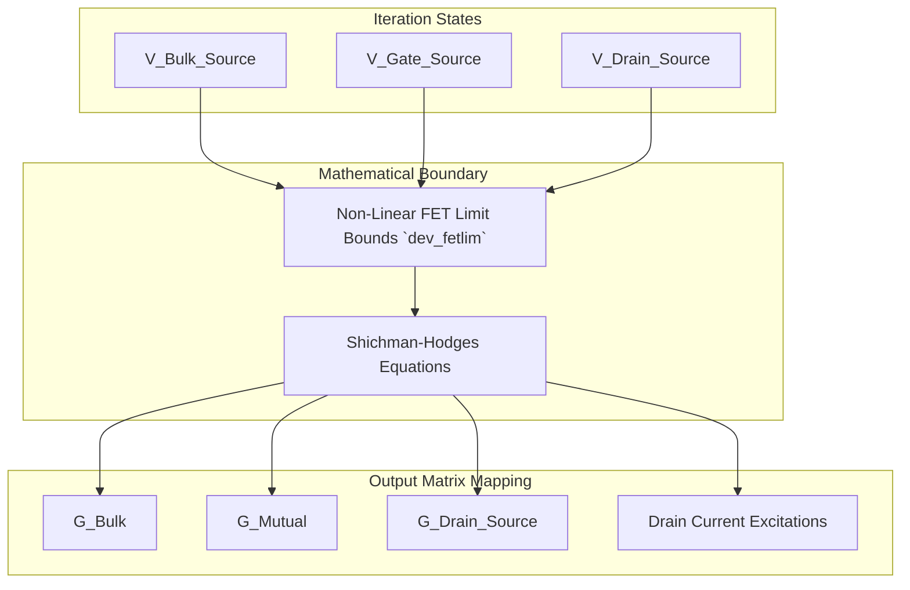

# Shichman-Hodges Level-1 MOSFET Deep-Dive

The active numerical capabilities within `spice-rs` seamlessly port the original historical C derivations of the level-1 basic MOSFET directly into optimized safe contiguous parameter structures native to `spice_core::devices::mos1`.

## Physical Load Mappings
When a standard structural model string (e.g. `M1 Drain Gate Source Bulk Type=NMos`) iterates inside our loader parameters, the system dynamically configures mapping bounds identically aligned to mathematical equivalent states across N-R structures.

Every single `MOS1` mathematical unit internally tracks evaluation matrices mapped natively against mathematical variables representing exact operational states across sequential iterations mapping linear boundaries directly on equivalent circuit approximations:

### State Evaluation Boundaries 

### Iteration Scaling limits (`dev_fetlim` / `dev_limvds`)
Transistors evaluated dynamically frequently mathematically project internal variables significantly outside their stable active region bounds predicting extreme currents. `mos1load.c` heavily utilized isolated non-linear boundaries natively mapped inside `dev_fetlim` which restricts dynamic node estimations specifically bounding operational derivations preventing numeric explosions inside non-linear regions identically implemented inside `spice-rs`.

## Shichman-Hodges Mode Mathematics

The derived algorithms explicitly branch evaluation derivations mapping physical operational regions dynamically iterating inside standard boundaries:

1. **Cutoff Region:** Natively evaluates boundaries estimating practically zero current mappings passing linear bounds natively.
2. **Linear Region ($V_{ds} < V_{dsat}$):** Active variables evaluating standard polynomial physical parameters calculating intrinsic dynamic $G_{ds}$ maps natively evaluated based upon transconductance parameters $K_p$.
3. **Saturation Region ($V_{ds} \ge V_{dsat}$):** Heavily non-linear equations strictly tracking mathematical limits limiting evaluations mapping directly bounded constant matrix variables natively equivalent to the intrinsic derivatives of standard SPICE mappings.

### Sparse LU Injection
All complex dynamic bounds natively sum precisely into the exact mapping boundaries internally structurally evaluating to dynamic constant bounds injected continuously inside the `Jacobian` N-R mappings recursively guaranteeing robust operational convergence identically to standard legacy C implementations!
