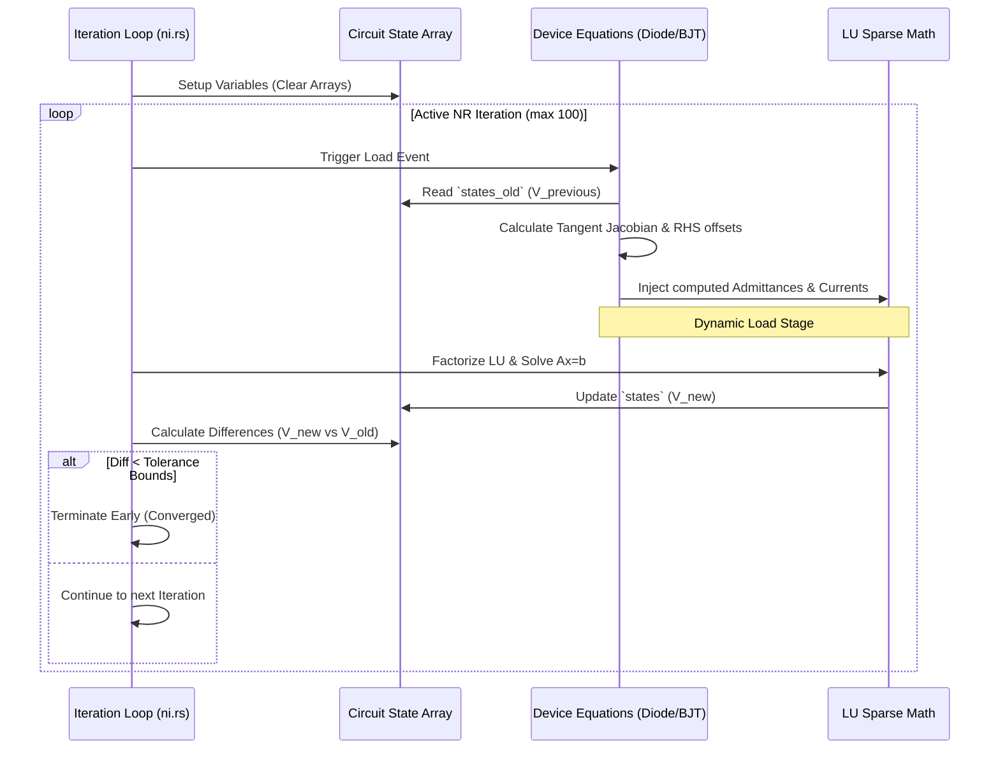

# Non-Linear Active Mechanics

Evaluating linear elements (Resistors, Independent Sources) can be fully synthesized mathematically inside a single contiguous $Ax = b$ LU evaluation frame cleanly. 

However, mathematical sequences for components like **Diodes**, **BJTs**, and **MOSFETS** yield fundamentally non-linear differential and exponential equations (e.g. ideal Shockley current evaluations: $I = I_s (e^{V/V_t} - 1)$). These components dynamically change parameters inherently dependent upon iteration variables themselves.

SPICE accurately structures these problems by evaluating linear Jacobian derivatives recursively at designated dynamic operational points iterating successively toward limits via **Newton-Raphson Analysis (N-R)**!

## The Newton-Raphson Solver Loop
This loop serves as the fundamental engine inside `ni.rs` (`spice_core::ni`).

## Bounding P-N Junction Limits 
A critical mechanism implemented inside `devsup.rs`!
During active iterations across heavily exponential non-linear functions, minor voltage differences across estimations could mathematically sky-rocket output currents into infinite computational bounds, shattering numerical stabilities entirely. 

To offset this, iterative step guesses naturally scale within maximum algorithmic limit boundaries:

If a dynamically converging PN junction evaluates differences exceeding intrinsic mathematical limits, `dev_pnjlim` dynamically scales the estimation guess utilizing a localized algorithmic log-linear limit approximation preventing overflow!

- `icheck = true`: Signals that the matrix solver passed numerical bounds preventing localized N-R limit breaks. N-R loops explicitly check evaluating convergence bounds explicitly validating `icheck == false` assuring stable mathematical equilibria natively!
